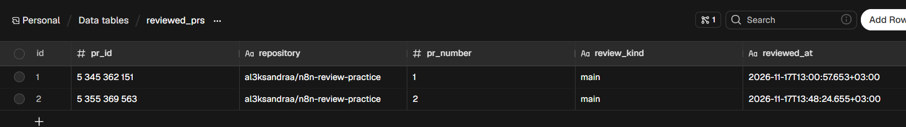
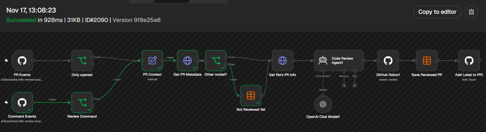
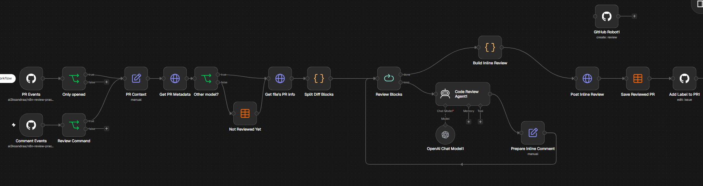
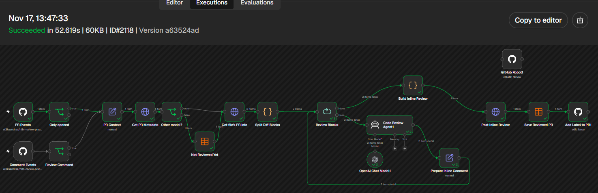
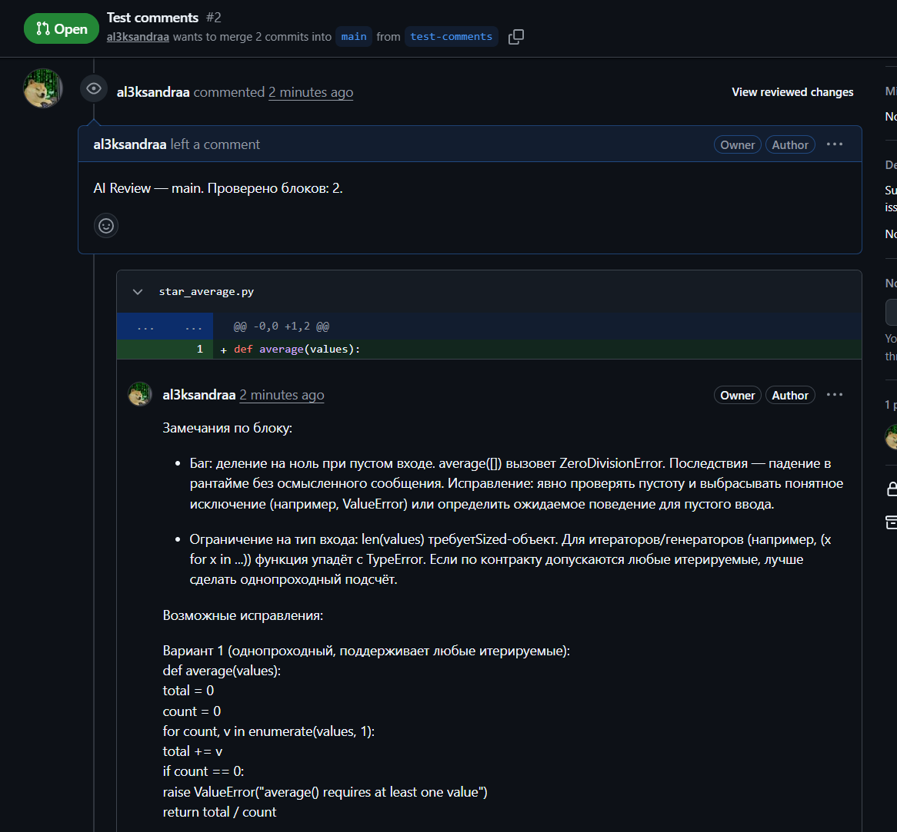
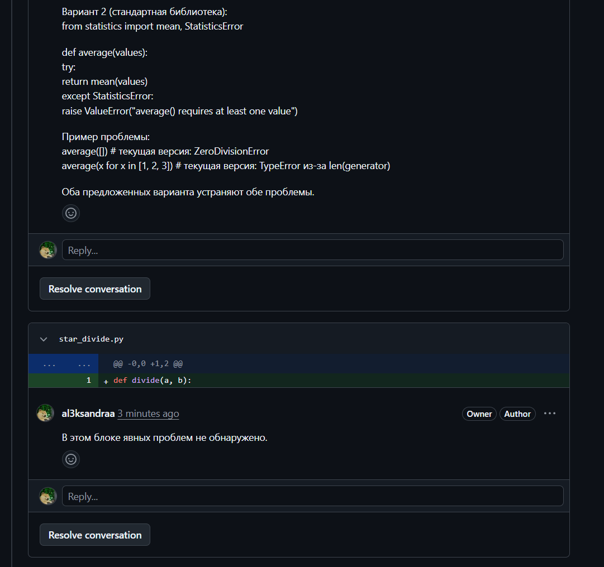

# Результаты домашней работы 7.1

Доработан ассистент для код-ревью в n8n. Результаты и подтверждения приведены в порядке этапов задания.

## 1. Вторая модель

Добавлена команда `/make_other_ai_review`: основная модель — `openai/gpt-5`, вторая — `anthropic/claude-sonnet-4`. Результаты публикуются в PR.

Обе модели обнаружили затенение встроенной `sum` и изменение типа исключения в `divide`. Вторая модель дополнительно отметила поддержку итераторов и рекомендации по оформлению кода.

- [PR №1 — сравнение моделей](https://github.com/al3ksandraa/n8n-review-practice/pull/1): [основная модель](reviews/ai_review.md), [вторая модель](reviews/other_ai_review.md).
- [Workflow основной части ДЗ](workflows/homework_models_and_deduplication.json).

## 2. Хранение состояния в Data Table

После успешного ревью в Data Table `reviewed_prs` сохраняются ID PR, репозиторий, номер PR, вариант модели и время проверки.

## 3. Блокировка повторного ревью

Повторный `/make_ai_review` для сохранённого PR останавливается на `Not Reviewed Yet`, без вызова модели. Для `/make_other_ai_review` повторный запуск разрешён.

Остановка подтверждена в Execution #2090:

## 4. Точечные комментарии — задание со звёздочкой

Patch разбивается на блоки `@@`, каждый блок обрабатывается отдельно. Комментарии собираются в одно review и привязываются к строкам через `path`, `line` и `side`.

- [Итоговый workflow со звёздочкой](workflows/homework_inline_reviews.json).
- [PR №2 — комментарии к блокам кода](https://github.com/al3ksandraa/n8n-review-practice/pull/2).

Итоговая схема:

Успешная обработка двух блоков — Execution #2118:

Опубликованные комментарии к двум блокам в PR №2:

