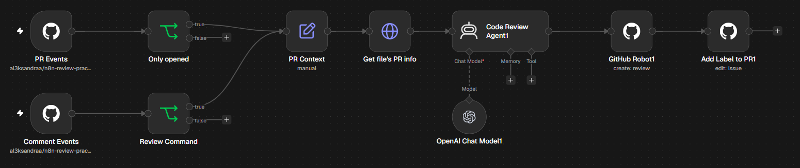
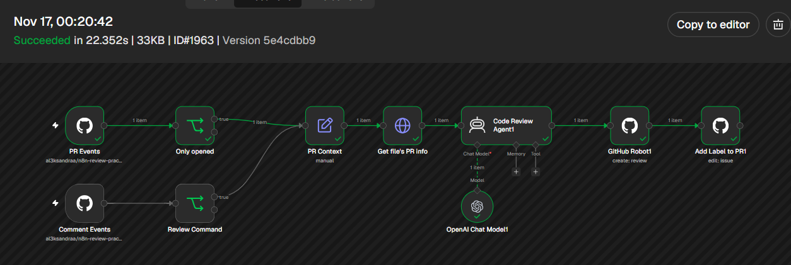
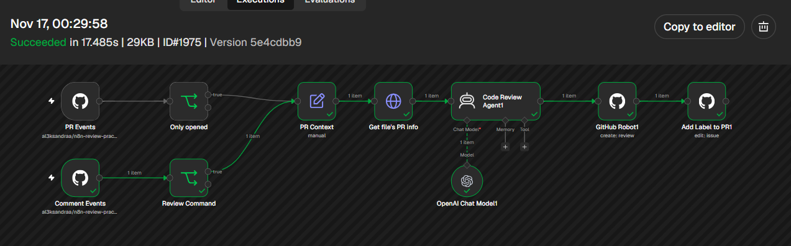

# Результаты практики 7.1

В n8n настроен ассистент для код-ревью GitHub Pull Request:

- Автоматическое ревью запускается только при открытии PR (`action = opened`).
- Комментарий `/make_ai_review` во вкладке Conversation запускает ревью по команде.
- Обе ветки передают данные через `PR Context`: сценарий получает diff, отправляет его AI Agent, публикует ревью и добавляет метку `ReviewedByAI`.

Материалы:

- [Тестовый PR №1](https://github.com/al3ksandraa/n8n-review-practice/pull/1).
- [Экспорт workflow в JSON](workflows/practice_ai_review.json).

Схема сценария:

Успешный запуск при открытии PR — Execution #1963:

Успешный запуск по команде `/make_ai_review` — Execution #1975:

