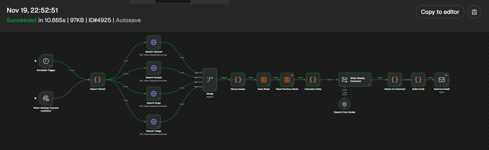
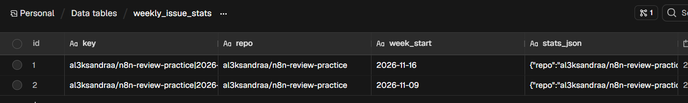
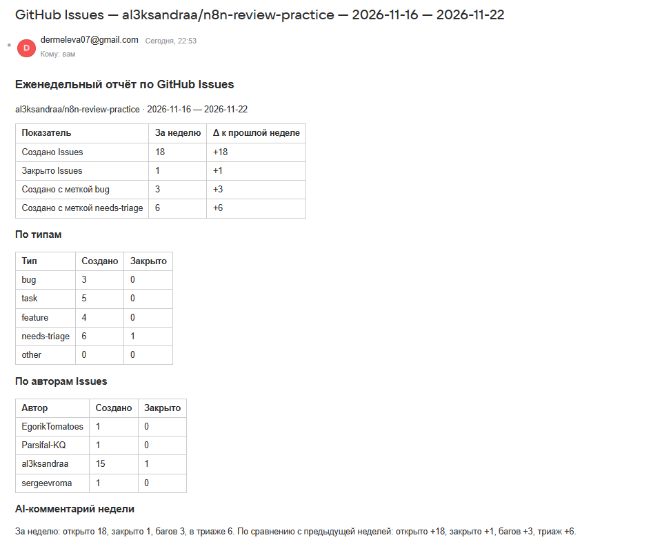

# Результаты домашней работы 7.2

Тестовый репозиторий — [al3ksandraa/n8n-review-practice](https://github.com/al3ksandraa/n8n-review-practice).

Экспорты — [Workflow 1](workflows/issues.json), [классификатор](workflows/classifier.json) и [еженедельный отчёт](workflows/weekly-report.json).

## 1. Классификация Issues

Новые Issues получают метки `bug`, `task` или `feature`. При уверенности ниже `0.8` или неопределённом типе ставится `needs-triage`, комментарий для этой ветки отключён. Классификатор вызывается как отдельный workflow. [Схемы и прогоны первой части](practice_result.md)

## 2. Еженедельный отчёт

Schedule Trigger настроен на понедельник в 09:00 по Москве (`0 9 * * MON`). Четыре запроса к GitHub Search API собирают данные предыдущей календарной недели, а `Group Issues` группирует созданные и закрытые обращения по типам и авторам. `Send an Email` отправляет HTML-письмо через SMTP Gmail.

В повторном прогоне за 16–22 ноября 2026 года письмо показало 18 созданных и 1 закрытое обращение. Среди созданных было 3 с меткой `bug` и 6 с меткой `needs-triage`. Отдельный запрос `Search Triage` с фильтром `queries.triage` вернул то же число, что и разбивка по типам.

Прогон **#4925** завершился успешно. В **Executions** видна вся цепочка от четырёх запросов к GitHub до отправки письма.

## 3. Сравнение недель и AI-комментарий

`Save Week` записывает статистику в `weekly_issue_stats`, а `Read Previous Week` загружает предыдущую неделю для расчёта Δ. В таблице видны две записи с датами начала недели 9 и 16 ноября 2026 года.

В итоговом письме показано сравнение с нулевыми значениями предыдущей недели. Δ составила `+18` для созданных, `+1` для закрытых, `+3` для `bug` и `+6` для `needs-triage`. Basic LLM Chain сформировала блок «AI-комментарий недели» по этим данным. В отдельном прогоне проверено [сообщение при отсутствии предыдущей записи](screenshots/homework/02-no-previous-week.png).

