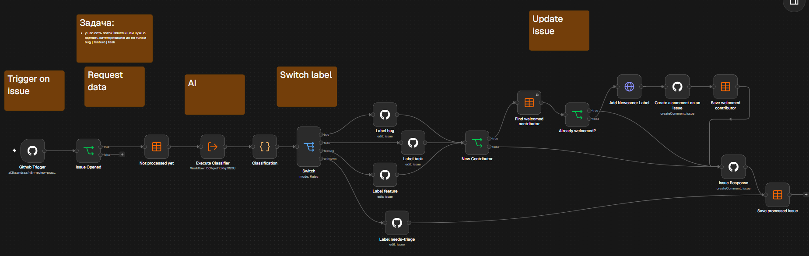
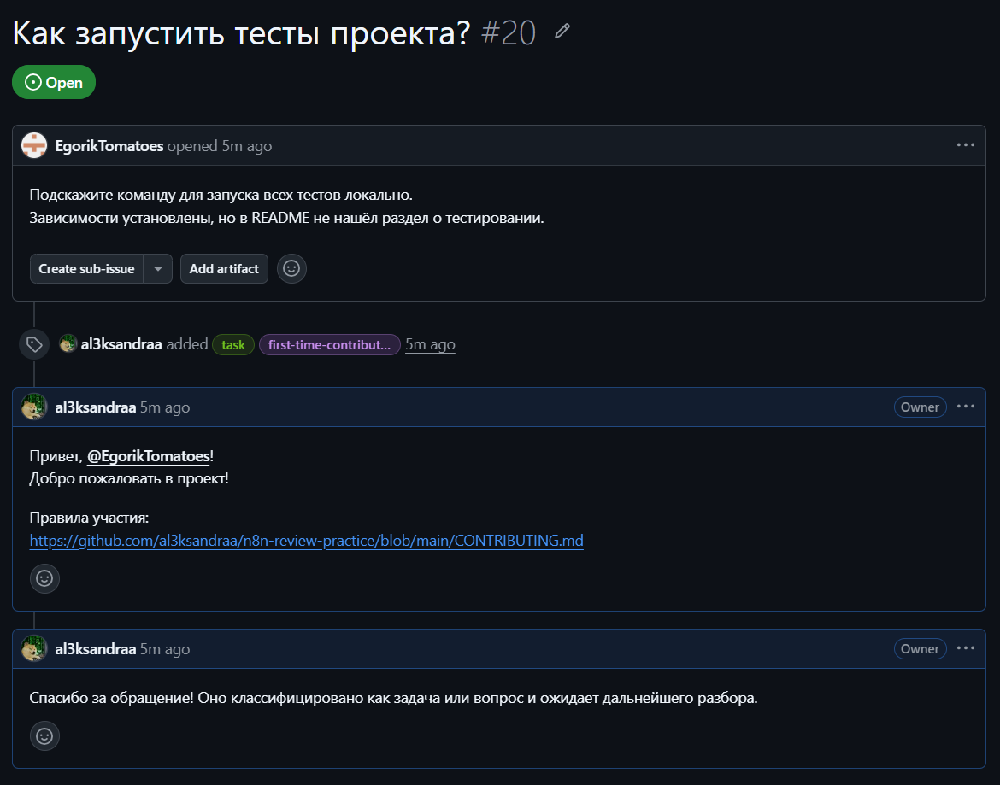
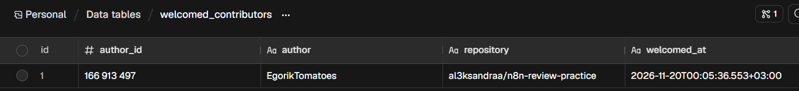
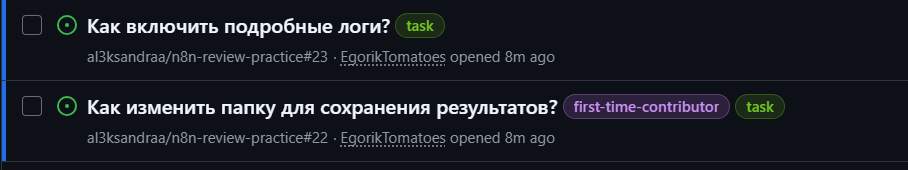
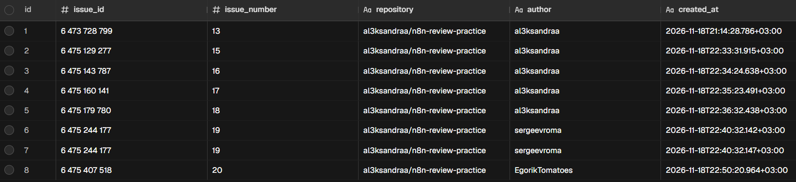
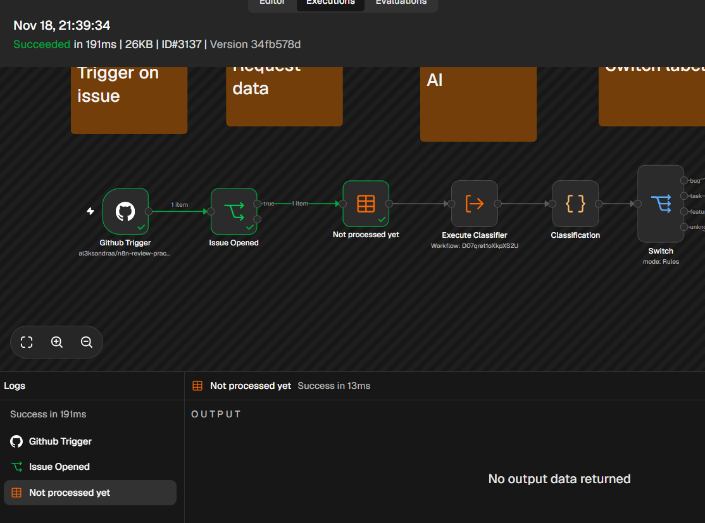

# Результаты практики 7.2

В n8n настроена автоматическая обработка GitHub Issues. Тестовый репозиторий: [al3ksandraa/n8n-review-practice](https://github.com/al3ksandraa/n8n-review-practice).

Экспорты: [итоговый workflow](workflows/issues.json), [Sub-workflow классификатора](workflows/classifier.json). Исходная [заготовка](workflows/source/Basic_issues_wf.json) сохранена отдельно.

Итоговая схема с проверкой обработанных Issues и ранее приветствованных авторов:

## 1. Классификация и эскалация

GitHub Trigger принимает события `issues`; фильтр пропускает только `action == "opened"`. AI-классификатор с Structured Output Parser возвращает `type` и `confidence`, Switch выбирает ветку `bug`, `task`, `feature` или `unknown`. Для определённых типов устанавливается метка и публикуется шаблонный ответ. При `confidence < 0.8` или неизвестном типе ставится `needs-triage`, без комментария.

## 2. Приветствие нового участника

Для уверенно классифицированного обращения с `author_association == "NONE"` нода `Find welcomed contributor` ищет автора в Data Table `welcomed_contributors` по паре `author_id` и `repository`. Если записи нет, добавляется метка `first-time-contributor`, публикуется приветствие со ссылкой на `CONTRIBUTING.md`, затем `Save welcomed contributor` сохраняет ID, логин, репозиторий и время приветствия через Upsert.

Если запись уже есть, `Already welcomed?` направляет обращение сразу в `Issue Response`: новое Issue получает обычный ответ без повторного приветствия и метки нового участника. Полный HTTP-ответ на добавление метки сохраняется одним элементом, чтобы комментарии не дублировались в рамках одного запуска.

Пример приветствия — [Issue №20](https://github.com/al3ksandraa/n8n-review-practice/issues/20):

В таблице сохранён автор `EgorikTomatoes` для тестового репозитория:

## 3. Отдельный классификатор

AI-логика вынесена в Sub-workflow: триггер принимает `title` и `body`, AI Agent с моделью `openai/gpt-5` и парсером выполняет классификацию, последняя нода возвращает `type` и `confidence`. Основной workflow вызывает его через `Execute Classifier` с ожиданием результата.

Схема Sub-workflow:

## 4. Дедупликация

Перед вызовом модели `Not processed yet` проверяет `issue.id` в Data Table `processed_issues`. После успешной обработки сохраняются ID и номер Issue, репозиторий, автор и время обработки. Запись сохраняется и для `needs-triage`.

Примеры сохранённых Issues:

Повторная обработка остановлена на проверке таблицы: Execution **#3137** завершился успешно, `Not processed yet` не вернул данных, классификатор не запускался.

