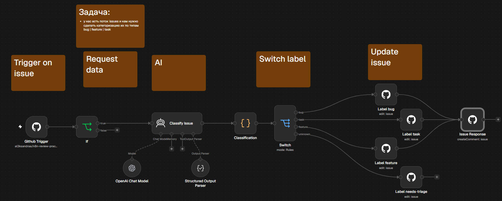
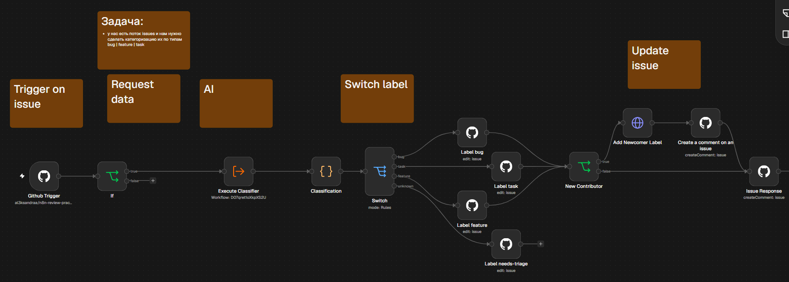
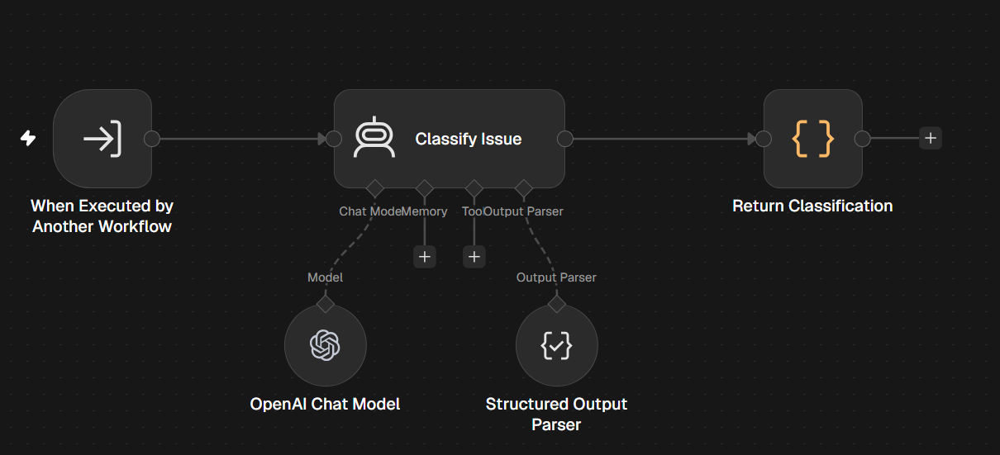

# Результаты практики 7.2

В n8n настроена автоматическая обработка GitHub Issues. Тестовый репозиторий: [al3ksandraa/n8n-review-practice](https://github.com/al3ksandraa/n8n-review-practice).

Экспорты: [итоговый workflow](workflows/issues.json), [Sub-workflow классификатора](workflows/classifier.json). Исходная [заготовка](workflows/source/Basic_issues_wf.json) сохранена отдельно.

## 1. Классификация и эскалация

GitHub Trigger принимает события `issues`; фильтр пропускает только `action == "opened"`. AI-классификатор с Structured Output Parser возвращает `type` и `confidence`, Switch выбирает ветку `bug`, `task`, `feature` или `unknown`. Для определённых типов устанавливается метка и публикуется шаблонный ответ. При `confidence < 0.8` или неизвестном типе ставится `needs-triage`, без комментария.

Схема базового этапа:

## 2. Приветствие нового участника

При `author_association == "NONE"` для уверенно классифицированного обращения добавляется метка `first-time-contributor` и приветствие со ссылкой на `CONTRIBUTING.md`. Полный HTTP-ответ на добавление метки сохраняется одним элементом, чтобы комментарии не дублировались.

В [Issue №20](https://github.com/al3ksandraa/n8n-review-practice/issues/20) видны метки `task` и `first-time-contributor`, одно приветствие и один ответ по типу обращения:

## 3. Отдельный классификатор

AI-логика вынесена в Sub-workflow: триггер принимает `title` и `body`, AI Agent с моделью `openai/gpt-5` и парсером выполняет классификацию, последняя нода возвращает `type` и `confidence`. Основной workflow вызывает его через `Execute Classifier` с ожиданием результата.

Схема этапа после выделения классификатора:

## 4. Дедупликация

Перед вызовом модели `Not processed yet` проверяет `issue.id` в Data Table `processed_issues`. После успешной обработки сохраняются ID и номер Issue, репозиторий, автор и время обработки. Запись сохраняется и для `needs-triage`.

Примеры сохранённых Issues:

Повторная обработка остановлена на проверке таблицы: Execution **#3137** завершился успешно, `Not processed yet` не вернул данных, классификатор не запускался.

